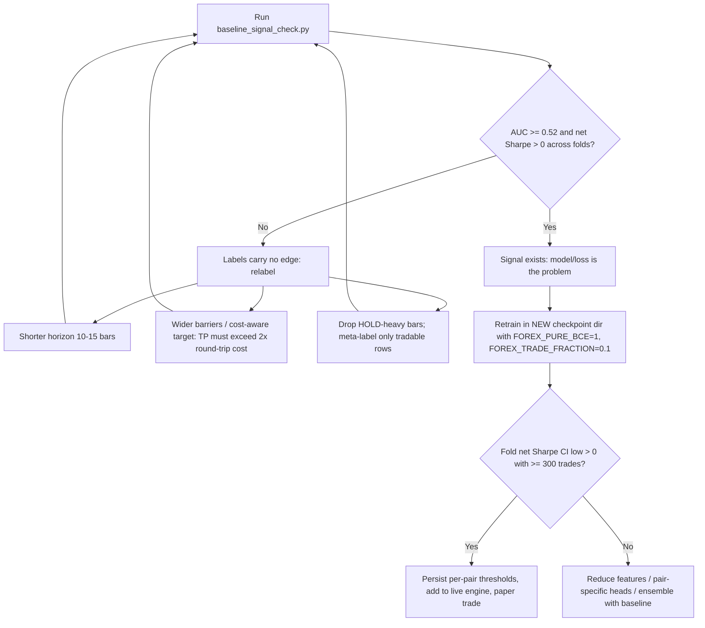

# Solution Plan: Fixing the Poor Sharpe in the Triple-Barrier HAELT Retrain

Date: 2026-10-11 · Scope: `checkpoints/haelt_triple_barrier_2018_2025`, dataset `dataset_scalping_5m_EURUSD-USDCAD-USDJPY_..._triple_barrier_...zarr`

## 1. Problem statement

Walk-forward retraining shows no tradable edge after costs:

| Evidence | Observation |
| :-- | :-- |
| Loss | Train loss flat (~1.46–1.51); val loss 1.58 → 1.55 over 14 epochs |
| Accuracy | `dir_acc` stuck at ~0.208 (below the 0.33 random baseline), near-constant predictions |
| Fold 1 "best" | Net Sharpe +0.32 from 42 trades, 95% CI [-2.07, +2.23], P(Sharpe ≤ 0) = 0.44 → noise |
| Fold 2 | Net Sharpe -1.5 to -4.7; 458 trades at epoch 14, win 41%, -2.29 bps/trade, CI [-8.4, -1.7] |
| Per pair | Sharpe flips sign every epoch (EURUSD +1.23 → -3.79 → -3.93 → -2.54) |
| Economics | TP 1.2 ATR / SL 0.8 ATR → breakeven win rate ≈ 40% before costs; observed 41–46%; cost ≈ 1.3 bps/trade |

## 2. Root-cause hypotheses (ranked)

1. **Weak or unpredictable labels.** One triple-barrier outcome per bar, 30-bar horizon, heavy overlap, ~17% HOLD.
2. **Loss / decision mismatch.** Trained with Huber on `return_hat`; traded on `sigmoid(direction) × sigmoid(conf)` plus an `|ret_hat| > deadband` hurdle.
3. **Untrained gate.** A fixed 0.15 deadband sits above the model's output scale for most of training; trading starts late and erratically.
4. **Selection on noise.** Best epoch chosen by a Sharpe from 40–450 trades.
5. **Little data per fold** (24k–73k bars × 3 pairs × 438 features, 252 masked).

## 3. Fixes already implemented (code, opt-in unless noted)

| Fix | File | Behaviour |
| :-- | :-- | :-- |
| Pooled gross Sharpe was never set (always `gross=0.000`) | `training/honest_eval.py` | Now computed; **always on** |
| Reliability guard | `training/loop_epochs.py` | Positive Sharpe from < 100 val trades scored 0 for selection (`TRAINING.min_reliable_val_trades`); **always on** |
| Pure BCE direction loss | `training/loop_losses.py` | `FOREX_PURE_BCE=1` zeroes `w_ret`, `w_quantile`, focal gamma |
| Hurdle bypass | `training/decision.py` | With pure BCE, skip the untrained `ret_hat` hurdle |
| Per-pair quantile gate | `training/decision.py`, `training/loop_epochs.py` | `FOREX_TRADE_FRACTION=0.1` (or `TRAINING.trade_fraction`): each pair trades only its most confident fraction by `max(P_sell, P_buy)`; thresholds are label-free and logged as `[Val][gate]` |
| Signal baseline | `scripts/baseline_signal_check.py` | CPU logistic regression + gradient boosting, walk-forward, embargoed, excludes lockbox |

Known gaps: the live engine does not apply per-pair thresholds; the gate smoke test after the directional-confidence fix did not finish (machine under load).

## 4. Decision procedure



## 5. Step-by-step plan

1. **Baseline (running).** `python scripts/baseline_signal_check.py --stride 6 --folds 4`. Read per-pair AUC, gross and net Sharpe.
2. **Branch on result** (see diagram).
   - **No signal:** change label parameters (`lookahead_bars`, `tp/sl` ATR multiples, spread-aware barriers), rebuild the dataset, and re-run the baseline before any deep training.
   - **Signal:** continue to step 3.
3. **Retrain (only after the current run finishes, or with a new `paths.checkpoint_dir`).**
   ```powershell
   $env:FOREX_PURE_BCE="1"; $env:FOREX_TRADE_FRACTION="0.1"
   $env:PYTHONPATH="d:/forex-main"; & ".venv311\Scripts\python.exe" -u scripts/train.py --full
   ```
4. **Acceptance gate (per fold):** ≥ 300 trades, net Sharpe > 0, bootstrap CI lower bound > 0, gross Sharpe > 0, no single pair dominating the PnL.
5. **Before live:** save per-pair thresholds (`validate_epoch.last_pair_thresholds`) with the checkpoint and apply them in `trading/live_engine.py` through `decide(..., pair_thresholds=...)`.
6. **Evaluate on the lockbox** (`172,144:191,271`) once, only for a model that passes step 4.

## 6. Risks and guardrails

- Do not promote any checkpoint from the current Fold 2 run; its selection was noise-driven.
- Keep CPAR benchmarks in `checkpoints/haelt_modern_2018_2025/` untouched.
- The lockbox must remain unseen until a final, single evaluation.
- Do not run GPU experiments alongside the active run; disk and CPU contention already slows every script.
- Do not enable live trading with a pure-BCE model until thresholds are applied live.

## 7. Success criteria

- Baseline shows AUC ≥ 0.52 (or labels are revised until it does).
- At least three consecutive folds with net Sharpe CI lower bound > 0 and ≥ 300 trades.
- Lockbox net Sharpe > 0 with positive gross Sharpe and net bps per trade above zero.
